# Kavrix: AI for Smart Public Safety

 CipherCop 2026 · Track 1: AI for Smart Public Safety (drones, facial recognition, live law-and-order surveillance, geospatial intelligence)

> **First on Scene. Private by Design. Proof That Holds.**

**Code:** https://github.com/GuruyuganKarthik8377/Kavrix. The campus test video and the volunteer's face crops are not in the repository (personal data); they are in the submission zip on the CipherCop Drive.

When a 112 call comes in, the nearest drone launches automatically and streams the scene to a live command map, so officers know what is happening before they arrive. On that same feed, Kavrix:

| | What it does |
|---|---|
| **Warns of crowd crushes early** | A drone-trained YOLOv8 model counts people, compensates for the drone's own motion, and turns density and crowd movement into a 0–100 risk score with a time-to-HIGH estimate. It alerts officers before a stampede risk peaks. |
| **Matches faces, privacy first** | Faces are checked only against a lawful, consented, expiring watchlist. Everyone else is pixelated and nothing about non-matches is stored. A match is only a *suggestion*: an officer must confirm it. |
| **Keeps court-ready evidence** | Every crowd event is SHA-256 hash-chained to the one before it and to its snapshot image. The backend signs each run's chain head with Ed25519. Every privileged action goes into a hash-chained audit log. |
| **Closes the loop to the officer** | Crowd alerts and confirmed matches become officer tasks, which the officer acknowledges and resolves on a phone view. |

**What is real and what is simulated.** The AI ran on real recorded footage (VisDrone/DroneCrowd, a Pexels concert clip, a Jülich crowd experiment, and a campus test with a consenting volunteer). The backend, hashing, signing, review flow and dashboard are real code. There is **no drone hardware**: drone positions, flights and 112 calls are simulated. See [Honest limits](#honest-limits).

---

## Contents

1. [Quick start](#quick-start-5-to-10-minutes)
2. [Judge walkthrough: the 6-step demo](#judge-walkthrough-the-6-step-demo)
3. [Page guide: all 11 pages, what to press](#page-guide-all-11-pages-what-to-press)
4. [How the system fits together](#how-the-system-fits-together)
5. [Project layout](#project-layout)
6. [Run the AI pipelines yourself](#run-the-ai-pipelines-yourself)
7. [Tests](#tests)
8. [API](#api)
9. [Honest limits](#honest-limits)
10. [Troubleshooting](#troubleshooting)
11. [Data, licences and team](#data-licences-and-team)
12. [License](#license)

---

## Quick start (5 to 10 minutes)

**You need:** Python 3.12 (3.11 also worked in our tests), Node 22 or newer, and internet access once (PyPI, npm, and a 15 MB face model on the first face run). Nothing else.

**Get the code:** `git clone https://github.com/GuruyuganKarthik8377/Kavrix.git` (or download the ZIP), then `cd Kavrix`.

**On Windows:** clone or unzip to a short folder such as `C:\Kavrix` (Windows limits paths to 260 characters and `node_modules` is deeply nested). Use Python 3.12 exactly if you can (`py -3.12 setup_haven.py --face` picks it when several versions are installed); newer versions such as 3.13 were not tested. Use the PowerShell commands below; `python3` does not exist on Windows, use `python`.

Open a terminal in this folder (`Kavrix`) and run two commands.

**macOS / Linux**

```bash
python3 setup_haven.py --face      # installs everything, builds the website, creates test logins
python3 start_haven.py             # starts the system on http://localhost:8000
```

**Windows (PowerShell)**

```powershell
python setup_haven.py --face
python start_haven.py
```

* `setup_haven.py` takes 5 to 10 minutes, depending on your connection and on `--face`. At the end it **prints the test logins once**; they are also saved in `backend/.env`. Leave the `start_haven.py` window open while you use the system.
* Leave out `--face` if you do not want the face AI (about 300 MB of packages). Everything except the live face worker still works, including the Campus test replay.
* Open **http://localhost:8000** in a browser. Use `localhost`, not a LAN IP (browsers only allow the hashing API there).

> **Without signing in, the site still demos.** It runs a built-in simulation. Signing in connects it to the real backend (green chip), which unlocks the live crowd replay, the face loop and the Campus test replay.

### Sign in (30 seconds)

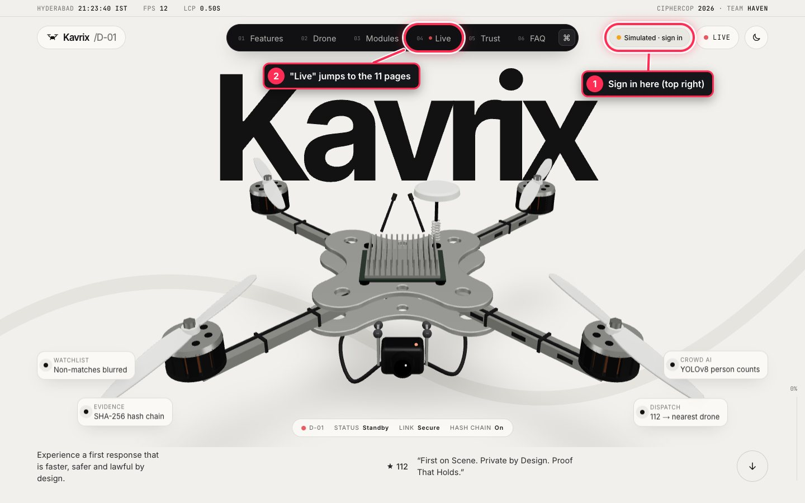

1. Click **Simulated · sign in** (top right).
2. The email is pre-filled (`commander@haven.test`). Type the **commander password** printed by setup (or copy it from `backend/.env`) and press **Sign in**.

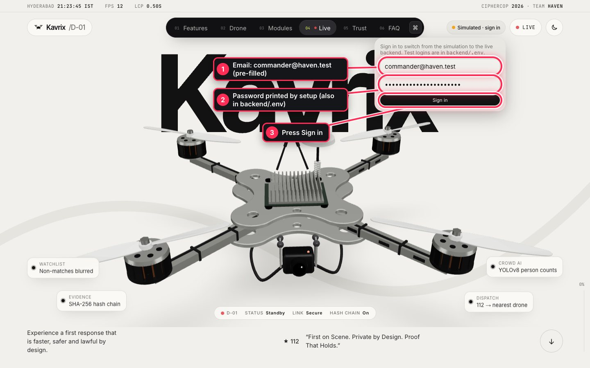

The chip turns green: **Backend live**. Click it again to see the replay buttons.

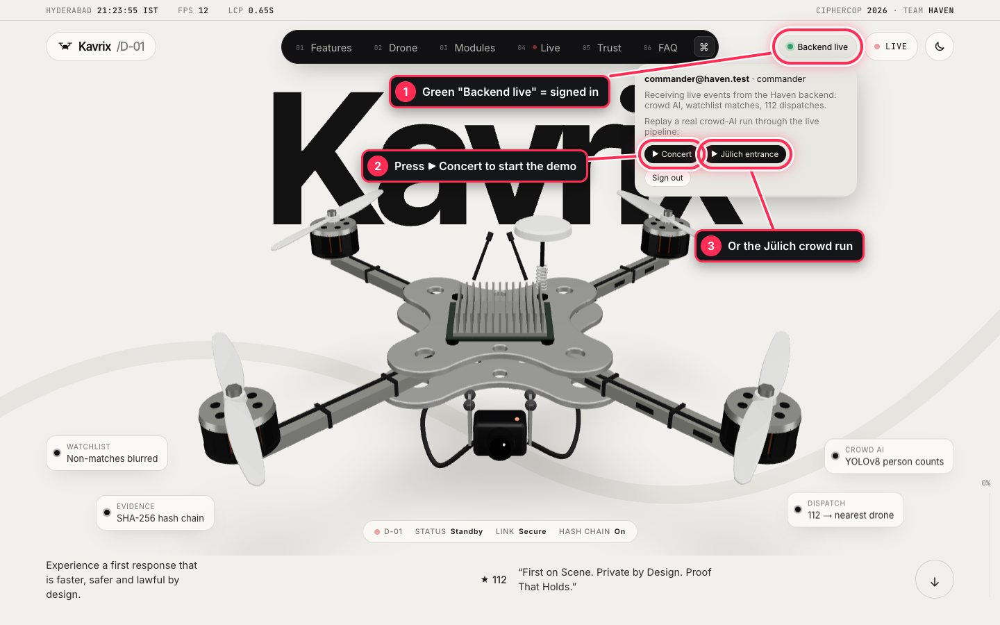

---

## Judge walkthrough: the 6-step demo

Do these in order; each takes about a minute. Every step is something you press, with what you should see.

### 1. Crowd-crush warning

Click the green chip, then **▶ Concert**. You land on the **Command centre**. Fifteen real crowd-AI events stream in, one per second. Risk climbs from LOW to HIGH, and a **Crowd alert** appears with the AI's message. Click the alert's **SHA-256 chip**: the backend re-checks the hash and the chip changes to **✓ Evidence verified**.

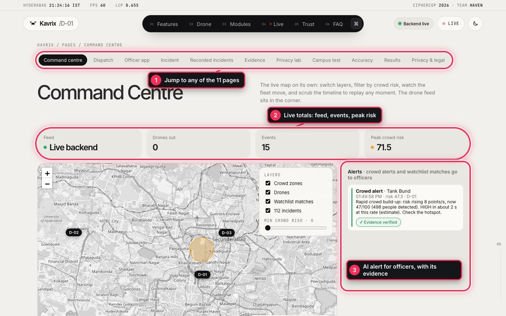

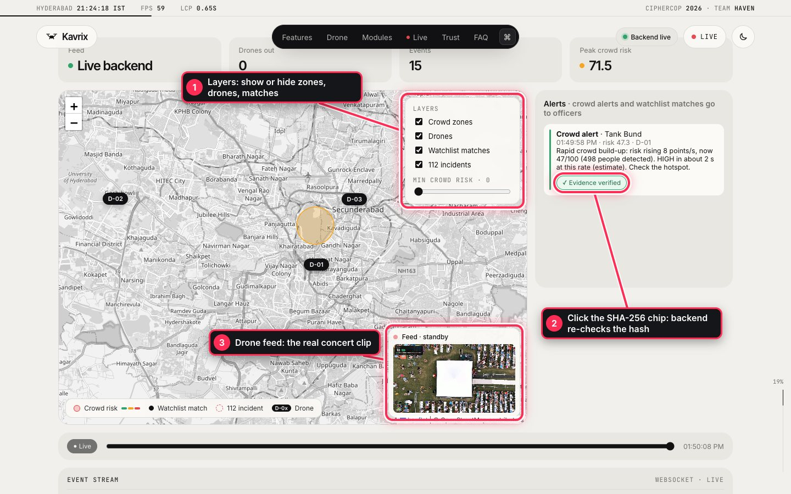

### 2. 112 call → drone

Open **Dispatch** (the pill row near the top of every page) and **click anywhere on the map**. The backend picks the nearest free drone, seals a `dispatch` event and pushes it live. The drone card turns to *En route* with distance and ETA, and the call appears in the log.

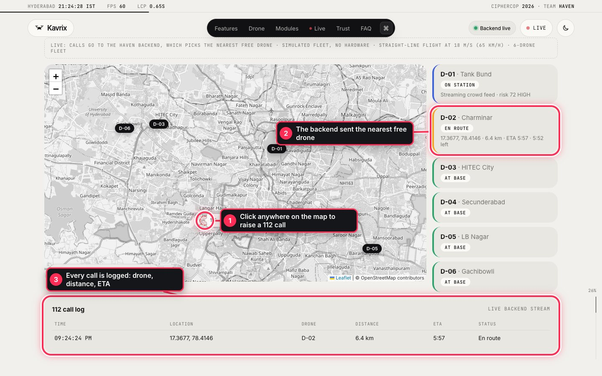

### 3. Privacy-first face matching

In a second terminal, in this folder, enrol the demo face and run the face worker (needs `--face` setup, and the backend must be running). The first command builds a short test clip from the photo that ships inside the `insightface` package, so no footage is stored in this repository.

**macOS / Linux**

```bash
cd ai/face
.venv/bin/python scripts/make_sample_video.py     # builds samples/sample.mp4 and samples/enroll_face.jpg (once)
.venv/bin/python enroll.py --label "Demo volunteer (consented sample)" --category missing_person --legal-basis "Demo: consent form HV-01" --consent-ref HV-01 --days 7 samples/enroll_face.jpg
.venv/bin/python worker.py --source samples/sample.mp4 --drone D-02 --lat 17.3616 --lng 78.4747
```

**Windows (PowerShell)**

```powershell
cd ai\face
.venv\Scripts\python scripts\make_sample_video.py     # builds samples\sample.mp4 and samples\enroll_face.jpg (once)
.venv\Scripts\python enroll.py --label "Demo volunteer (consented sample)" --category missing_person --legal-basis "Demo: consent form HV-01" --consent-ref HV-01 --days 7 samples\enroll_face.jpg
.venv\Scripts\python worker.py --source samples\sample.mp4 --drone D-02 --lat 17.3616 --lng 78.4747
```

The worker pixelates every face, matches the one consented face (about 96%), and uploads the privacy-safe video as signed evidence. Now open the **Officer app** page: a *Possible watchlist match* is waiting. Press **Confirm**. The backend records the decision and raises a **"Missing person located"** officer task.

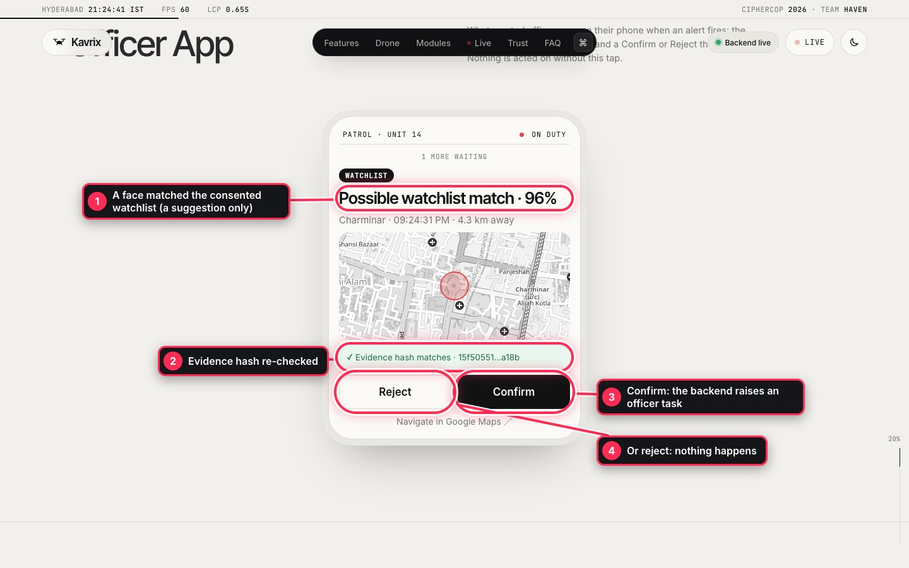

### 4. Evidence you can check yourself

Open **Evidence** and press **Verify this incident**. Every event is re-hashed in your browser. Then press **Tamper with a copy** and watch the check fail and point to the exact event.

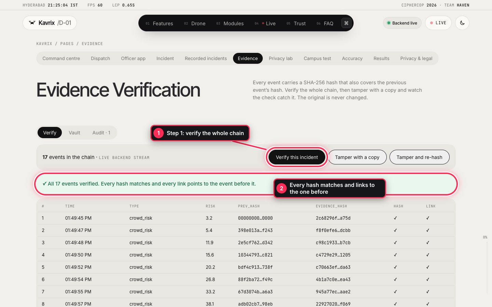

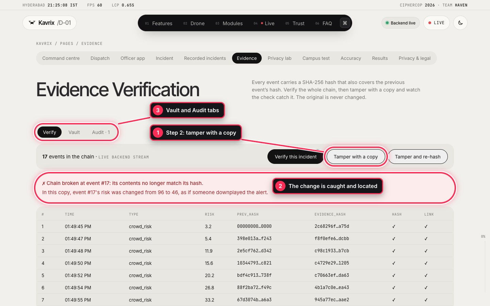

### 5. Real-footage face test (Campus test)

> **Note for GitHub clones:** the campus recording and the volunteer's face sheet show real people, so they are not published here (they are in the CipherCop submission zip: copy `campus_demo.mp4` and `enrolled_faces.jpg` into `ai/face/recorded/campus/` to play them). Without them the page shows a notice instead of the video; the numbers, the replay button and the Officer app flow work the same.

Open **Campus test**. Play the face team's recording: four campus clips where everyone is pixelated except a consenting volunteer, who is matched at 60%, 79% and 82%, and not in the clip without him. Press **Send the recorded matches to the live system**: as the video reaches each match it arrives in the **Officer app** as a pending review, and **Confirm** raises the same officer task. The page also shows the face team's held-out test and the limits.

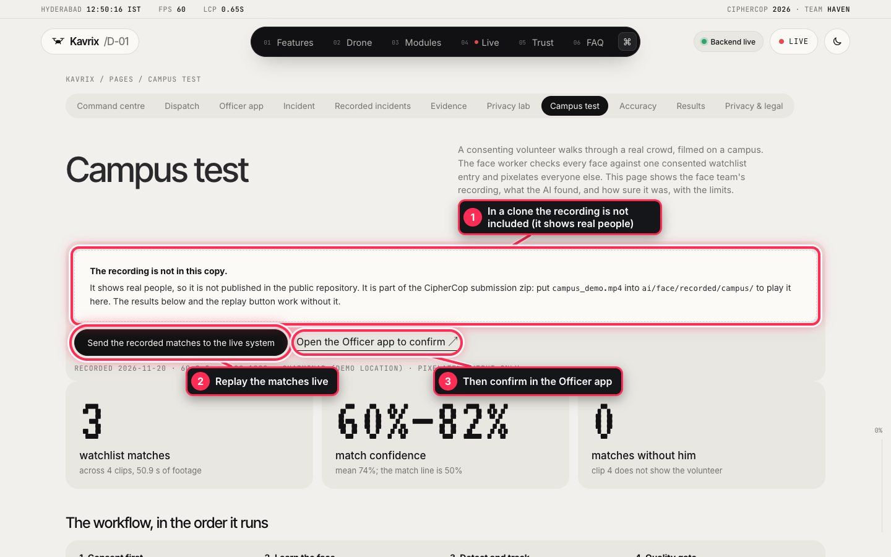

### 6. Read the numbers

**Accuracy** and **Results** list every headline number with its source, sample size and date. Anything not measured says so.

---

## Page guide: all 11 pages, what to press

### How to reach any page

* On the home page, scroll to **See Kavrix In Action** (or press **Live** in the top bar). The **11 tiles** at the bottom of that section open the pages.
* Once you are inside a page, the **pill row** under the page title jumps straight to any of the other 10 (it is circled in screenshot 1 of the Command centre below).
* The page list is repeated in the footer, and `Ctrl`/`Cmd` + `K` opens a section search.

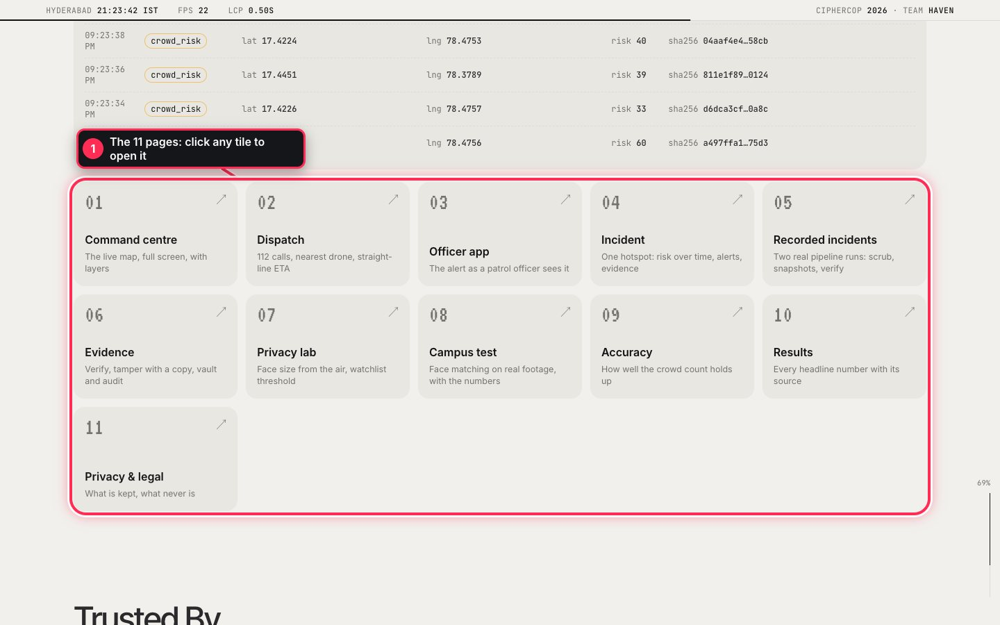

### Overview

| # | Page | Opens at | Needs sign-in? | What to press | What you see |
|---|---|---|---|---|---|
| 1 | [Command centre](#1-command-centre) | `#/command` | Best signed in | ▶ Concert (green chip) · SHA-256 chip · layers · timeline | Live map, alerts, event stream, drone feed |
| 2 | [Dispatch](#2-dispatch) | `#/dispatch` | Best signed in | Click the map | Nearest drone, ETA, call log |
| 3 | [Officer app](#3-officer-app) | `#/officer` | Best signed in | Confirm / Reject | The alert as a patrol officer sees it |
| 4 | [Incident](#4-incident) | `#/incident` | No | Hotspot tabs · Verify N events | One hotspot: risk over time, alerts, evidence |
| 5 | [Recorded incidents](#5-recorded-incidents) | `#/incidents` | No | ▶ Play · scrubber · Verify this incident | Two real pipeline runs, snapshot by snapshot |
| 6 | [Evidence](#6-evidence) | `#/evidence` | No | Verify · Tamper with a copy | Hash chain, tamper detection, vault, audit |
| 7 | [Privacy lab](#7-privacy-lab) | `#/privacy-lab` | No | Sliders · lens · resolution | How big a face is from the air |
| 8 | [Campus test](#8-campus-test) | `#/campus` | For the replay button | ▶ play · Send the recorded matches | Real-footage face matching with numbers |
| 9 | [Accuracy](#9-accuracy) | `#/analytics` | No | Read only | Crowd-count accuracy on 246 real frames |
| 10 | [Results](#10-results) | `#/results` | No | Measure verify time again | Every headline number with its source |
| 11 | [Privacy & legal](#11-privacy--legal) | `#/privacy` | No | Read only | What is kept, what is never kept |

"Best signed in" means it works in the simulation too, but shows the real backend data once you are signed in.

### 1. Command centre

The live map on its own. **To fill it:** sign in, click the green chip, press **▶ Concert** (or **▶ Jülich entrance**).

1. **Pill row**: jump to any of the 11 pages.
2. **Totals**: feed (simulated or live backend), drones out, events, peak crowd risk.
3. **Alert card**: the AI's warning for officers, with its evidence.


1. **Layers**: show or hide crowd zones, drones, watchlist matches, 112 incidents, and filter by minimum crowd risk.
2. **SHA-256 chip**: click it. The backend re-checks the hash and the chip becomes *✓ Evidence verified*.
3. **Drone feed**: the corner panel plays the real concert clip.


1. **Replay timeline**: drag to replay any moment.
2. **Event stream**: one line per event with its hash.

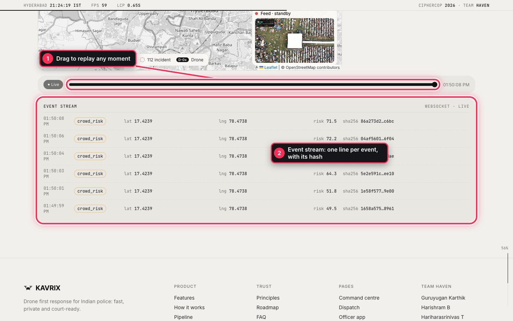

### 2. Dispatch

Every 112 call goes to the nearest free drone with a straight-line ETA. In live mode the page shows exactly what the backend reports (6 simulated drones, flight at 18 m/s).

1. **Click anywhere on the map** to raise a call.
2. The chosen drone's card turns to *En route* with distance and ETA.
3. The **call log** lists every call with drone, distance, ETA and status.


### 3. Officer app

What a patrol officer sees on a phone when an alert fires. It shows the latest alert (a crowd alert or a face match) with its evidence check. **To get a face match:** do demo step 3, or run the Campus test replay.

1. The alert: here a possible watchlist match with its confidence.
2. **Evidence hash** re-checked against the backend.
3. **Confirm**: the backend records your decision, raises an officer task and writes the audit log.
4. **Reject**: nothing is raised.

Nothing is acted on without this tap.


### 4. Incident

One hotspot at a time: how crowd risk moved, which alerts fired, and whether the evidence behind them still verifies.

1. **Hotspot tabs**: pick a place (the number is its event count).
2. **Risk chart**: risk over time against the HIGH line, alerts marked.
3. **Map**: where it happened.

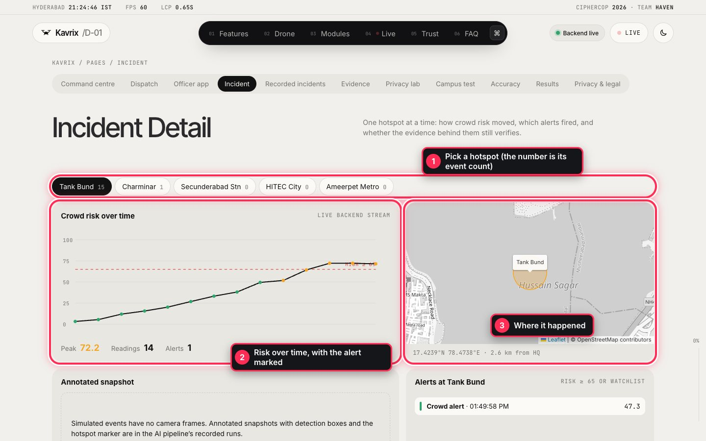

1. **Verify N events**: re-hashes this hotspot's events in your browser.
2. **Alerts** raised at this hotspot.

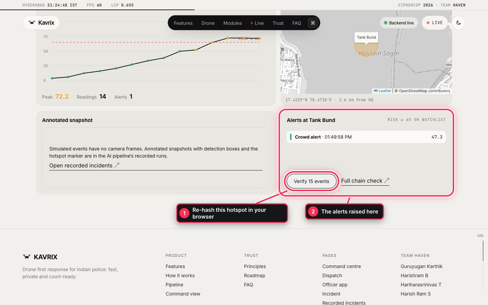

### 5. Recorded incidents

Two runs of the real AI pipeline on real footage, exactly as it wrote them. Works without the backend.

1. **Choose a recorded run**: *Concert clip* or *Jülich entrance* (a controlled crowd-crush experiment).

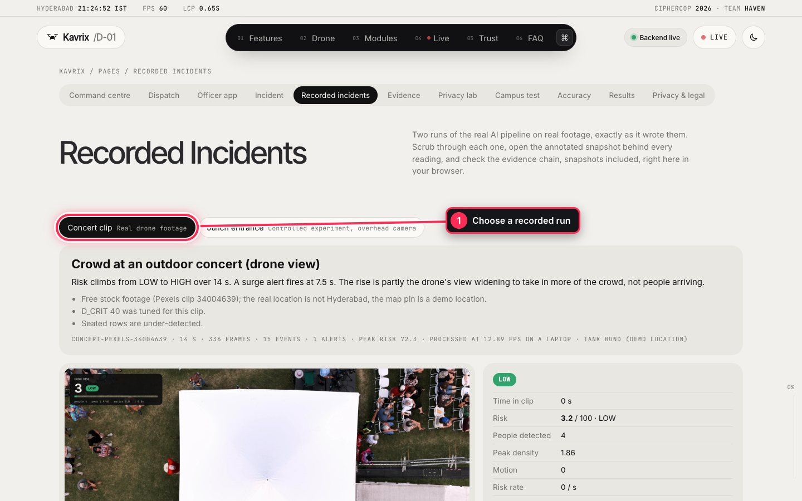

1. **▶ Play** the run back, or **scrub** to any second. The annotated snapshot behind every reading is shown.

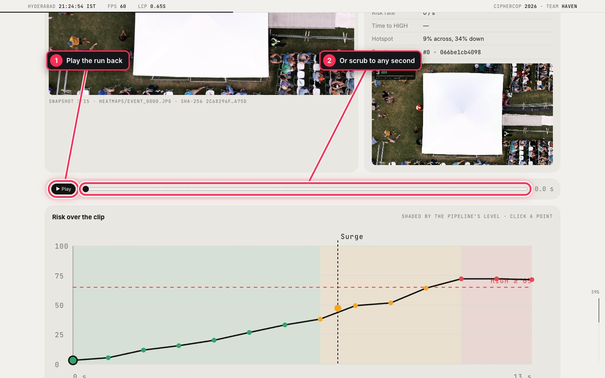

1. **Verify this incident**: checks every hash and every snapshot in your browser (Web Crypto, no backend).
2. **Tamper with a copy**: edits one value in a copy and shows the check fail. *Delete an alert from a copy* and *Rewrite the whole chain* show other attacks and what they do and do not prove.

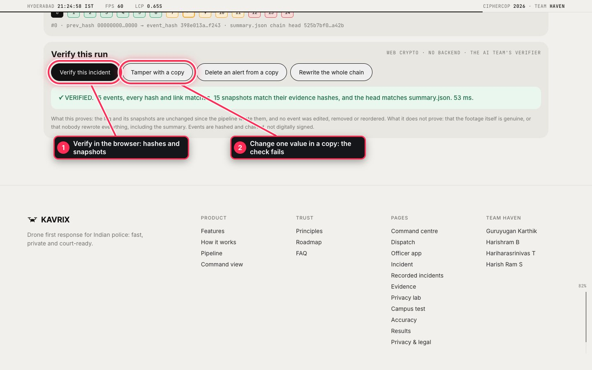

### 6. Evidence

Every event carries a SHA-256 hash that also covers the previous event's hash.

1. **Verify this incident**: re-hash the whole chain (crowd AI events and dispatch/watchlist events).
2. The green banner: every hash matches and every link points to the event before it.


1. **Tamper with a copy**: changes one risk value in a copy. (*Tamper and re-hash* also recomputes that hash, so the next link breaks instead.)
2. The red banner names the broken event. The original is never changed.
3. **Vault** tab: every chain with its latest hash and a *Verify now* button. **Audit** tab: every Confirm or Reject you made this session.


### 7. Privacy lab

Try the limits yourself.

1. **Sliders** (altitude, horizontal distance): how big a face is from the air.
2. **Lens and resolution** buttons (82°, 47°, 15°; 1080p, 4K).
3. The **verdict** (not detectable, blurrable, matching unreliable, matching feasible) changes as you move them. Lower on the page: a before/after blur and the watchlist flow.

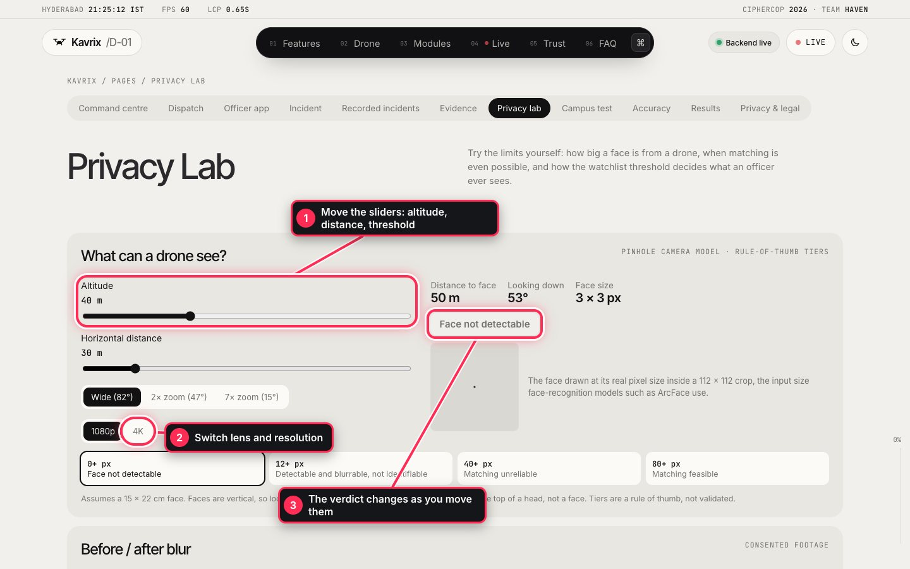

### 8. Campus test

The face team's test on real campus footage. The page works without signing in; the replay button needs the green chip. In a GitHub clone the recording itself is absent (see the note in demo step 5), so the first item below shows a notice.

1. The **recording**: four campus clips, everyone pixelated except the consenting volunteer's match (boxed in red with its confidence).
2. **Send the recorded matches to the live system**: as the video passes each match (about 9, 21 and 52 s), it appears as a pending review.
3. **Open the Officer app to confirm**.


1. The face team's **results**: 3 matches, 60–82%, none in the clip without him.
2. The **seven-step workflow**, the four clips, the held-out test (photos alone found 84% of his faces; after learning from video, 100%), the faces learned, and the **limits**.

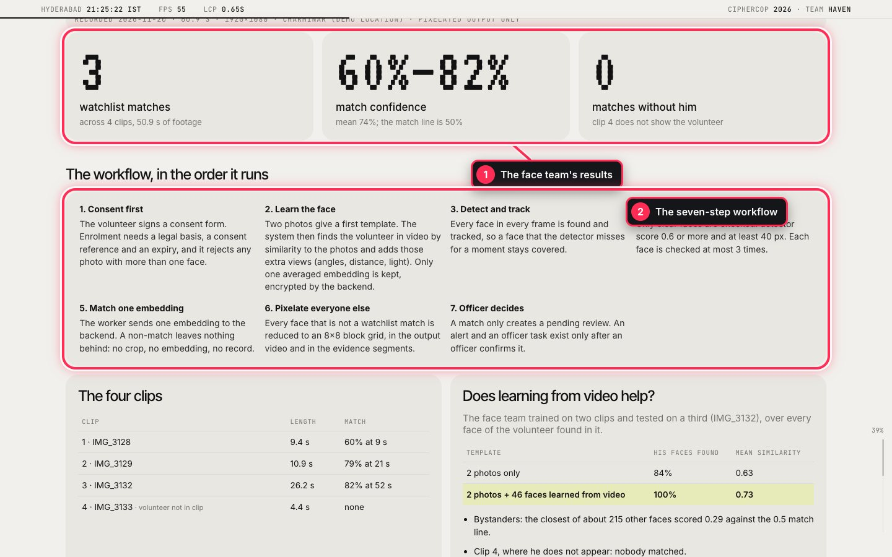

### 9. Accuracy

How well the crowd count holds up on 246 real DroneCrowd frames. Read only.

1. The headline numbers: the detector finds about 89% of people (median), with a typical error of 32% (51 people).
2. The breakdown by crowd size, the settings compared, validation runs and charts further down, with limits and sources.

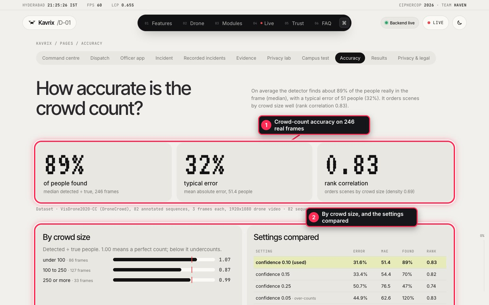

### 10. Results

Every headline number in one place, with where it comes from, how much data is behind it, and when. Anything not measured says so instead of showing a guess.

1. The **table**: crowd counting, validation runs, face matching, privacy, evidence verify time and page speed.

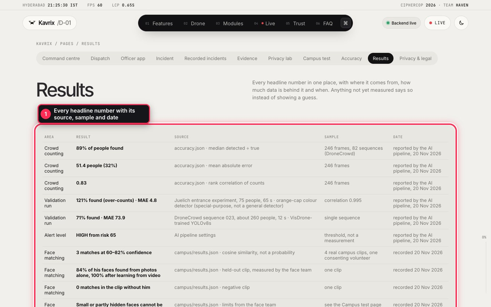

1. **Measure verify time again**: re-hashes the live chain in your browser and shows the time.
2. Link to the Campus test details.

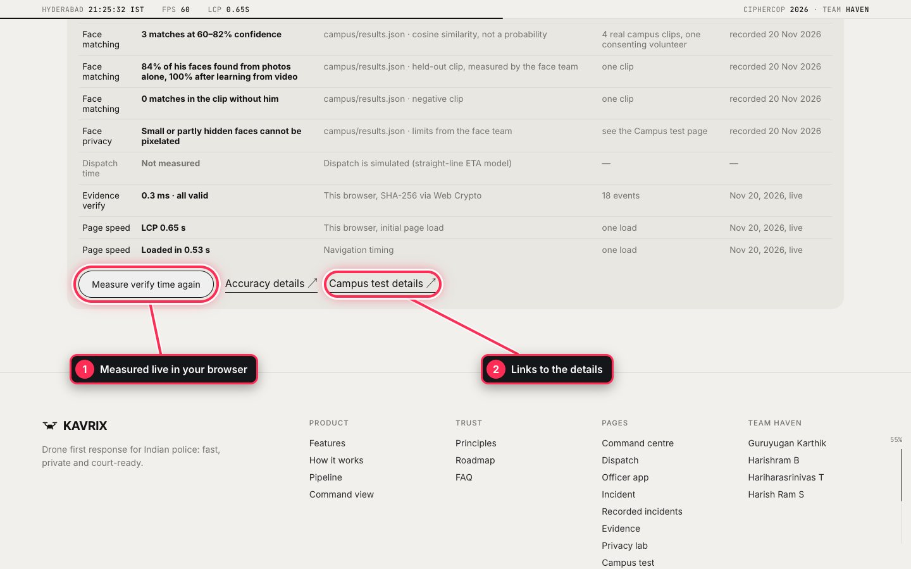

### 11. Privacy & legal

How Kavrix limits what it sees, keeps and does. It describes the prototype as built, and the rules proposed before any real deployment. Read only.

1. **Kept**: alert events, annotated snapshots, watchlist matches, officer decisions.
2. **Never kept**: faces of non-matches, identities of the crowd, continuous raw video, locations of individuals. Below: consent, data minimisation, retention, human oversight, evidence integrity, legal review.

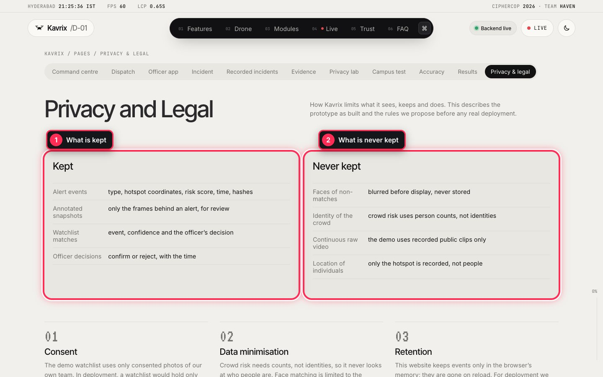

---

## How the system fits together

```
 drone video ──► AI: Crowd and Scene (ai/crowd)  ──POST /events──┐
                 YOLOv8-VisDrone · density · motion · risk       │
                                                                 ▼
 drone video ──► AI: Face and Privacy (ai/face) ──► Backend (backend/, FastAPI)
                 InsightFace · track · pixelate     /watchlist/match · /segments
                                                    auth (roles) · SQLite · Ed25519 signing
                                                    hash-chain verify · 112 dispatch · officer tasks
                                                    audit log · WebSocket /ws/events
                                                                 │
                                                                 ▼
                                   Frontend: Kavrix (frontend, React + Leaflet + three.js)
                                   command map · dispatch · officer app · evidence · privacy lab
```

* **Events** from the crowd AI are stored unchanged, checked against their hash and chain, de-duplicated on `id`, and the run's chain head is signed.
* **Face matches** reach the backend as one embedding. A match becomes a *pending review*, never an alert by itself. An officer's **Confirm** creates the task.
* The dashboard gets one contract event per WebSocket message, including sealed `dispatch` and `watchlist_match` events.

## Project layout

Three parts, one folder each, plus the two scripts you ran above.

```
Kavrix/
├── README.md              this file
├── LICENSE                MIT licence
├── DATASETS.md            data used, where it comes from, licences
├── setup_haven.py         one-time setup (backend deps, website build, test logins)
├── start_haven.py         starts everything on http://localhost:8000
├── backend/               BACKEND: FastAPI, SQLite, signing, dispatch, audit
│   ├── app.py             API and WebSockets
│   ├── haven_core.py      storage, hashing, signing, encryption
│   ├── fleet.py           simulated drone fleet and 112 dispatch
│   └── smoke_test.py      end-to-end test (26 checks)
├── frontend/              FRONTEND: Kavrix website (React, Vite, Leaflet, three.js)
│   ├── src/               pages, components, event store
│   └── public/            recorded data, charts and the concert clip the pages use
├── ai/                    AI
│   ├── crowd/             Crowd and Scene: crowd-risk pipeline, model, evaluation, recorded runs
│   │   ├── code/          crowd_risk.py, evaluation, verifiers, tests
│   │   ├── sample_data/   two recorded runs (concert, jl030) with snapshots
│   │   └── results/       accuracy tables and charts
│   └── face/              Face and Privacy: detect, match, pixelate, enrol
│       ├── worker.py · enroll.py · identify.py · facepriv.py
│       ├── recorded/campus/   the face team's campus results (the recording is not published)
│       └── tests/
└── docs/screenshots/      the annotated screenshots used in this README
```

Each of `backend/`, `frontend/`, `ai/crowd/` and `ai/face/` has its own README with its details.

## Run the AI pipelines yourself

**Face and privacy:** see demo step 3. Options and privacy rules are in [`ai/face/README.md`](ai/face/README.md).

**Crowd risk on a new clip.** This needs the model packages (`pip install -r ai/crowd/code/requirements.txt`, which includes PyTorch; a GPU helps) and your own drone video. Keep the backend running and signed in, then:

```bash
python3 ai/crowd/code/crowd_risk.py clip.mp4 --out runs/my_clip --model ai/crowd/code/models/yolov8s-visdrone/best.pt --classes 0,1 --imgsz 1920 --conf 0.15 --d-crit 40 --lat 17.4239 --lng 78.4738 --realtime --api http://localhost:8000/events
```

Events stream to the Command centre as they are produced, and every snapshot is verified by the backend. Runs saved under `runs/` also appear as replay buttons in the green chip's panel. To replay a recorded run from the command line:

```bash
python3 ai/crowd/code/post_events.py ai/crowd/sample_data/jl030 --api http://localhost:8000/events
```

Full reference: [`ai/crowd/README.md`](ai/crowd/README.md).

## Tests

Start the backend first (`python3 start_haven.py`). `smoke_test.py` clears the backend's events when it finishes, so run it **before** the demo, or press **▶ Concert** first before the contract test (it compares what the backend stores with the 15 recorded events).

| Command (macOS / Linux) | What it checks | Result |
|---|---|---|
| `backend/.venv/bin/python backend/smoke_test.py` | Auth and roles, crowd ingest, server-side chain, snapshot and signature verification, tamper detection, watchlist enrol/match/no-match, human review, officer tasks, signed segments, 112 dispatch, recorded campus face run, audit chain | 26/26 |
| `python3 ai/crowd/code/contract_test.py --fetch http://localhost:8000/events --expect ai/crowd/sample_data/concert` | The backend returns the AI's events unchanged, value for value | Passes (15 events) |
| `ai/face/.venv/bin/python ai/face/tests/test_privacy.py` | Pixelation, tracking, quality gate, query cap, backend-down fail-safe | Passes |
| `cd frontend && npm test` | Event contract, dispatch model, browser verifier | 16/16 |
| `python3 ai/crowd/code/test_risk.py` (needs the crowd packages) | Risk maths, alert logic, hashing, schema, sender | Passes |

On Windows replace `backend/.venv/bin/python` with `backend\.venv\Scripts\python` (and `ai/face/.venv/bin/python` with `ai\face\.venv\Scripts\python`).

## API

Log in with `POST /auth/login` (roles: `commander`, `officer`, `worker`); tokens last one hour. Interactive docs: **http://localhost:8000/docs**.

| Endpoint | Who | Purpose |
|---|---|---|
| `POST /auth/login` | all | Returns a bearer token |
| `POST /events` | crowd AI | Ingest a crowd event: de-duplicated on `id`, hash and chain checked, run head signed |
| `GET /events`, `GET /runs`, `GET /runs/{id}/verify`, `GET /verify/{id}` | staff | Events unchanged; full server-side verification (chain, snapshots, Ed25519 head) |
| `POST /watchlist`, `GET /watchlist`, `DELETE /watchlist/{id}` | commander | Consented, expiring entries; embeddings encrypted at rest and destroyed on removal |
| `POST /watchlist/match` | worker | Cosine match ≥ 0.5 → pending review; no match → nothing stored |
| `GET /reviews`, `POST /reviews/{id}` | officer, commander | Human-in-the-loop confirm or reject |
| `POST /segments`, `GET /segments/{id}/verify` | worker / staff | Privacy-safe video, hashed, chained per drone and signed |
| `POST /dispatch/112`, `GET /drones`, `GET /incidents` | staff | Nearest-drone dispatch, simulated flight at 18 m/s |
| `GET /tasks`, `POST /tasks/{id}` | officer | Officer alert loop: acknowledge, resolve, false alarm |
| `GET /audit`, `GET /audit/verify` | commander | Hash-chained audit log |
| `GET /demo/recordings`, `POST /demo/replay/{name}`, `GET /demo/face-runs`, `POST /demo/face-replay/{name}` | commander | Replay a recorded crowd run or the recorded campus face run through the same paths as live data |
| `WS /ws/events?token=` | dashboard | One contract event per message |

## Honest limits

* **No drone hardware.** Drone positions, flights and 112 calls are simulated. The AI ran on real recorded footage, not a live feed.
* **Crowd count.** The detector finds about 89% of people (median) with a typical error of 51 people (32%) on 246 VisDrone-CC frames. The risk threshold is tuned per clip, and no dataset contains a real stampede. See [`ai/crowd/README.md`](ai/crowd/README.md).
* **Face matching on real footage.** In the face team's campus recording the volunteer is matched at 60%, 79% and 82% (cosine similarity, not a probability) in the 3 clips that show him, and never in the clip without him. Matching depends on the template and on when the checks happen: re-running the same footage on this backend gave 2 matches at 59–64%. One volunteer, one campus: a feasibility test, not a benchmark. Small or partly hidden faces cannot be pixelated. Details in [`ai/face/recorded/campus/README.md`](ai/face/recorded/campus/README.md).
* **Face model licence.** InsightFace pretrained models are for non-commercial research only. That is fine for a hackathon; production needs a licensed model. The match threshold must be re-checked at real drone altitudes.
* **Evidence proves integrity, not truth.** The chain shows nothing changed after capture. It does not prove the camera saw the truth. The signing key lives on the backend host (`backend/data/`); production would use an HSM.
* **Campus footage is not included.** The raw clips show bystanders, and the pixelated recording and the volunteer's face sheet show real people, so none of them are published in this repository. Only the numbers (`ai/face/recorded/campus/results.json`) are.
* **Demo-grade security.** Test logins are random per setup and the server listens on `127.0.0.1` only. The AI ingest endpoints (`POST /events`, `POST /snapshots`) are open unless `HAVEN_INGEST_KEY` is set, login has no rate limiting, and the signing key is a file on the host. Do not expose this server to a network as it is.

## Troubleshooting

| Problem | Fix |
|---|---|
| `Run python setup_haven.py first.` | You started before setting up. Run `setup_haven.py`, then `start_haven.py`. |
| `npm not found: install Node 22+` | Install Node 22 or newer from nodejs.org, then run setup again. It is safe to repeat. |
| Windows: `The system cannot find the path specified` or very long path errors | Move the folder to a short path such as `C:\Kavrix` and run setup again. |
| Windows: `python` opens the Microsoft Store | Install Python 3.12 from python.org and tick *Add python.exe to PATH*, or run `py -3.12 setup_haven.py --face`. |
| Port 8000 is busy | Close the other program (or an old `start_haven.py` window). |
| The chip shows *Connecting…* or you were signed out | The backend restarted. Click the chip, sign in again. |
| Forgot the password | It is in `backend/.env` (`COMMANDER_PASSWORD`). |
| Face install fails | It needs a C++ compiler on some systems; setup falls back to a build without the 3D-mesh part. If it still fails, skip `--face`: the Campus test replay needs no face install. |
| The Officer app shows no face match | Run demo step 3, or press **Send the recorded matches** on the Campus test page. |
| Want a clean state | Sign out and sign in, or `POST /demo/reset` as commander. |

## Data, licences and team

Data sources, licences and what is and is not included are in [`DATASETS.md`](DATASETS.md).

**Maintainer:** Guruyugan Karthik ([@GuruyuganKarthik8377](https://github.com/GuruyuganKarthik8377)).

**Team Haven (CipherCop 2026):** Guruyugan Karthik, Harishram Balamurugan, Hariharasrinivas T, Harish Ram S.

## License

The code in this repository is released under the [MIT License](LICENSE), © 2026 Guruyugan Karthik.

Third-party parts keep their own terms: [Ultralytics YOLOv8](https://github.com/ultralytics/ultralytics) is AGPL-3.0, InsightFace pretrained models are non-commercial research only, the bundled fonts are SIL OFL, and the datasets and clips are listed in [`DATASETS.md`](DATASETS.md). Check those before any commercial use.
